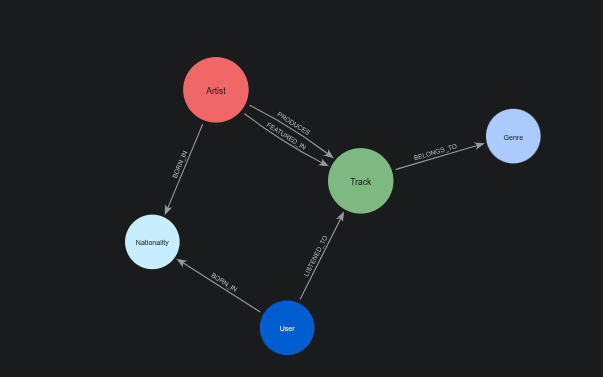

# 🎧 Graph Music — Recomendação de músicas com Neo4j

Projeto do bootcamp **Neo4j (DIO)**: uma rede de streaming de música modelada como **grafo** no
**Neo4j AuraDB**, com uma aplicação **Angular** que mostra, para cada ouvinte, o que ele já escutou e
**o que ouvir a seguir** — e explica *por que* cada música foi recomendada.

🔗 **Demo:** https://gbraga.github.io/bootcamp-ne4j-dio_music_recommendation/

---

## ✨ O que a aplicação faz

- Seleciona um ouvinte e exibe o **histórico** (plays, curtidas, desde quando ouve) e as **recomendações**.
- As recomendações são a **união de 4 algoritmos** escritos em Cypher — cada um com seu card, sua cor e a
  consulta exibida na tela.
- Cada algoritmo pode ser **ativado ou desativado** por um interruptor; a lista é recalculada na hora.
- Clicar em um card **destaca** as músicas que vieram daquele algoritmo.
- Um card **"Seu algoritmo"** permite **escrever e executar a sua própria consulta Cypher**.
- É possível **cadastrar novos ouvintes**, que já recebem recomendações imediatamente.
- **Player com prévias de 30 s** e **like**: cada play e cada curtida são gravados no grafo para o ouvinte
  selecionado — e as recomendações se recalculam na hora.
- Fotos reais dos artistas (licenças livres do Wikimedia Commons, com crédito).

---

## 🕸️ Modelo do grafo



```
(:User)-[:LISTENED_TO {timesListened, liked, listenDate}]->(:Track)
(:Artist)-[:PRODUCES]->(:Track)          
(:Artist)-[:FEATURED_IN]->(:Track)
(:Track)-[:BELONGS_TO]->(:Genre)
(:User)-[:BORN_IN]->(:Nationality)       
(:Artist)-[:BORN_IN]->(:Nationality)
```

Os dados ficam em [`resources/datasets`](resources/datasets): 25 ouvintes, 25 artistas reais, 35 músicas
reais (com duração e data de lançamento verdadeiras), 25 gêneros, 14 nacionalidades e 70 audições
plausíveis (nunca antes do lançamento, nem antes de o ouvinte ter idade para isso). O arquivo
[`neo4j_importer_model.json`](resources/datasets/neo4j_importer_model.json) pode ser aberto no
**Neo4j Data Importer**.

---

## 🧠 Os 4 algoritmos de recomendação

Todos excluem músicas que o ouvinte **já escutou**. Músicas sugeridas por **mais de um algoritmo** sobem
para o topo da lista.

### 1. 🟣 Da sua geração
Músicas que **outros ouvintes com até 5 anos de diferença de idade** estão escutando — ranqueadas pelo
número de ouvintes e, em seguida, pelo total de plays.

```cypher
MATCH (me:User {userId: $userId})
MATCH (peer:User)-[listen:LISTENED_TO]->(track:Track)
WHERE peer <> me
  AND abs(peer.age - me.age) <= $ageRange
  AND NOT (me)-[:LISTENED_TO]->(track)
WITH track, count(DISTINCT peer) AS listeners, sum(listen.timesListened) AS plays
RETURN track.trackId AS trackId, listeners, plays
ORDER BY listeners DESC, plays DESC
LIMIT 5
```

### 2. 🟢 Dos seus artistas
Outras músicas **e parcerias** dos artistas que o ouvinte já escuta (como artista principal ou convidado).
Ex.: quem ouve Paul McCartney recebe *Ebony and Ivory* (com Stevie Wonder).

```cypher
MATCH (me:User {userId: $userId})-[:LISTENED_TO]->(:Track)<-[:PRODUCES|FEATURED_IN]-(artist:Artist)
MATCH (artist)-[:PRODUCES|FEATURED_IN]->(track:Track)
WHERE NOT (me)-[:LISTENED_TO]->(track)
WITH track, collect(DISTINCT artist.name) AS knownArtists
RETURN track.trackId AS trackId,
       knownArtists,
       COUNT { (track)<-[:PRODUCES|FEATURED_IN]-(:Artist) } > 1 AS isPartnership
ORDER BY size(knownArtists) DESC, isPartnership DESC
```

### 3. 🟡 Top 3 da plataforma
As **3 músicas mais tocadas** de toda a plataforma (soma de `timesListened`) que o ouvinte ainda não ouviu.

```cypher
MATCH (me:User {userId: $userId})
MATCH (:User)-[listen:LISTENED_TO]->(track:Track)
WHERE NOT (me)-[:LISTENED_TO]->(track)
WITH track, sum(listen.timesListened) AS plays
RETURN track.trackId AS trackId, plays
ORDER BY plays DESC
LIMIT 3
```

### 4. 🩷 Gêneros que você curte
A partir das músicas que o ouvinte **curtiu**, encontra os **3 gêneros com mais likes** e recomenda outras
músicas desses gêneros.

```cypher
MATCH (me:User {userId: $userId})-[:LISTENED_TO {liked: true}]->(:Track)-[:BELONGS_TO]->(genre:Genre)
WITH me, genre, count(*) AS likes
ORDER BY likes DESC
LIMIT 3
MATCH (genre)<-[:BELONGS_TO]-(track:Track)
WHERE NOT (me)-[:LISTENED_TO]->(track)
WITH track, collect(genre.name) AS likedGenres, sum(likes) AS score
RETURN track.trackId AS trackId, likedGenres, score
ORDER BY score DESC
LIMIT 5
```

### ✍️ Bônus: escreva o seu próprio algoritmo
O primeiro card, **"Seu algoritmo"**, traz um editor de Cypher com destaque de sintaxe. A consulta recebe
`$userId`, deve retornar a coluna **`trackId`** e, opcionalmente, **`reason`** (o texto exibido como motivo
da recomendação). Ela participa da união como os outros algoritmos.

O exemplo inicial recomenda músicas **curtidas por ouvintes da mesma nacionalidade**:

```cypher
MATCH (me:User {userId: $userId})-[:BORN_IN]->(country:Nationality)
MATCH (country)<-[:BORN_IN]-(peer:User)-[:LISTENED_TO {liked: true}]->(track:Track)
WHERE peer <> me AND NOT (me)-[:LISTENED_TO]->(track)
WITH track, country, count(DISTINCT peer) AS fans
RETURN track.trackId AS trackId,
       'Curtida por ' + fans + ' ouvinte(s) de nacionalidade ' + country.name AS reason
ORDER BY fans DESC
LIMIT 10
```

> A consulta roda em **transação de leitura**: comandos de escrita (`CREATE`, `SET`, `DELETE`…) são
> rejeitados pelo próprio Neo4j.

---

## 🆕 Novo ouvinte: recomendações desde o primeiro acesso

Pelo botão **＋ Novo ouvinte** você cadastra nome, idade e nacionalidade — a aplicação cria o nó `:User`
ligado à `:Nationality` por `BORN_IN`.

Mesmo **sem ter ouvido nenhuma música**, o novo ouvinte **já recebe recomendações** — o clássico problema
de *cold start* resolvido pelo grafo:

- 🟣 **Da sua geração** — usa apenas a **idade** informada no cadastro para encontrar ouvintes parecidos;
- 🟡 **Top 3 da plataforma** — usa a popularidade geral, que independe do histórico.

Os algoritmos **"Dos seus artistas"** e **"Gêneros que você curte"** dependem do histórico e das curtidas,
então passam a contribuir conforme o ouvinte for escutando músicas.

E a experiência é personalizável: o ouvinte pode **escolher quais algoritmos quer ativar** (o interruptor de
cada card) e até **escrever o seu próprio algoritmo** em Cypher — como o exemplo por nacionalidade, que
também já funciona para quem acabou de chegar.

O ouvinte é gravado no **AuraDB** (não apenas na tela): ele continua na lista ao recarregar a página e em
qualquer outro acesso. Só o `npm run seed`, que recria o grafo a partir dos CSVs, o removeria.

---

## ▶️ Player e likes: o grafo aprende com o ouvinte

Cada música recomendada (e do histórico) tem um botão **▶** sobre a foto do artista. Ele abre o player
no rodapé, que toca uma **prévia de 30 segundos** e tem o botão **♥ curtir** e o link **"Ouvir completa"**
no Apple Music.

Tudo é **persistido no ouvinte selecionado**, direto no grafo:

```cypher
// ▶ play: cria a relação na primeira vez e soma um play nas seguintes
MERGE (user)-[listen:LISTENED_TO]->(track)
  ON CREATE SET listen.timesListened = 1, listen.liked = false, listen.listenDate = datetime()
  ON MATCH SET  listen.timesListened = listen.timesListened + 1

// ♥ like
MERGE (user)-[listen:LISTENED_TO]->(track)
SET listen.liked = $liked
```

Depois de cada play ou like, histórico e recomendações são recalculados — a música tocada sai das
recomendações, e curtir, por exemplo, uma MPB faz o algoritmo **"Gêneros que você curte"** passar a sugerir
outras MPBs. É o ciclo completo: o novo ouvinte começa com **"Da sua geração"** e **"Top 3"** e, conforme
ouve e curte, **"Dos seus artistas"** e **"Gêneros que você curte"** entram em ação.

> As prévias (AAC/.m4a) vêm da **iTunes Search API** da Apple, buscadas uma vez e guardadas em
> `tracks.csv` (`preview_url`, `apple_music_url`). Funcionam no Chrome, Edge, Firefox e Safari; navegadores
> embutidos sem o codec AAC (como o do VS Code) mostram um aviso. *Tití Me Preguntó* não tem prévia
> disponível e aparece sem o botão de play.

---

## 🏗️ Arquitetura

Aplicação **Angular sem backend**, que conversa direto com o AuraDB pelo driver oficial
(`neo4j-driver`), organizada em camadas:

```
music-recommender/src/app
├── core/neo4j/        Conexão com o Neo4j (driver único, leitura/escrita)
├── data/
│   ├── queries/       Consultas Cypher em arquivos .cypher (o mesmo texto é executado e exibido)
│   ├── repositories/  Executam as consultas e devolvem dados tipados
│   └── seed/          Importação dos CSVs (automática quando o banco está vazio)
├── domain/            Modelos, algoritmos, união das recomendações e regras de usuário
├── features/          Componentes de UI (página, cards, sidebar, dialog de novo ouvinte)
└── shared/            Utilitários de apresentação (realce de Cypher, duração, bandeiras)
```

Detalhes técnicos em [`music-recommender/README.md`](music-recommender/README.md).

---

## 🚀 Como rodar localmente

Pré-requisitos: **Node.js 20+** e uma instância **Neo4j AuraDB Free**.

1. Copie [`.env.example`](.env.example) para `.env` e preencha com as credenciais da sua instância.
2. Instale e rode:

   ```bash
   cd music-recommender
   npm install
   npm start            # http://localhost:4200
   ```

Na primeira abertura, se o banco estiver vazio, a aplicação **importa os CSVs automaticamente**.
Para recriar o grafo do zero: `npm run seed`.

---

## 🌐 Publicação (GitHub Pages)

O workflow [`.github/workflows/main.yml`](.github/workflows/main.yml) faz o build e publica a cada push na
`main`. As credenciais vêm dos **Repository secrets** `NEO4J_URI`, `NEO4J_USERNAME`, `NEO4J_PASSWORD` e
`NEO4J_DATABASE` (*Settings → Secrets and variables → Actions*), e o Pages deve usar a fonte
**GitHub Actions** (*Settings → Pages*).

> ⚠️ **Aviso de segurança:** por não haver backend, as credenciais do AuraDB vão no JavaScript publicado
> e podem ser lidas por qualquer visitante. Use uma instância **exclusiva para demonstração** — os dados
> podem ser restaurados a qualquer momento pelos CSVs — e troque a senha ao final da demo.

---

## 🛠️ Tecnologias

Neo4j AuraDB · Cypher · Angular 22 (signals, standalone components) · TypeScript · neo4j-driver ·
Vitest · GitHub Actions / Pages

Fotos dos artistas: [Wikimedia Commons](https://commons.wikimedia.org) (CC BY, CC BY-SA e domínio público),
com autor e licença exibidos na aplicação.
