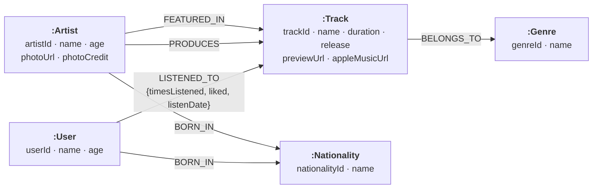
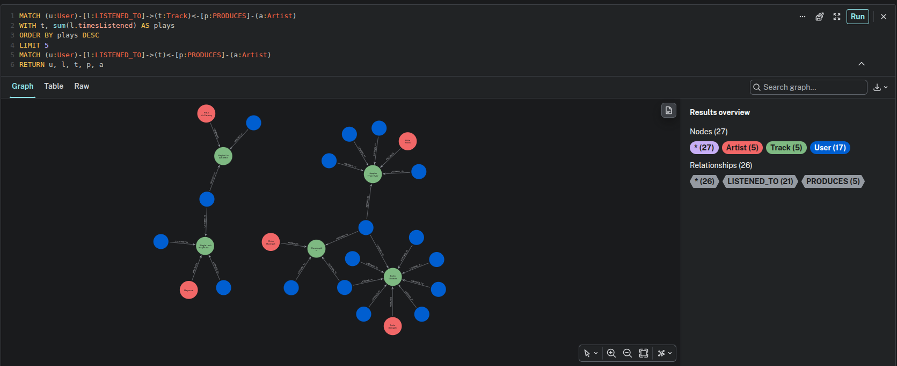
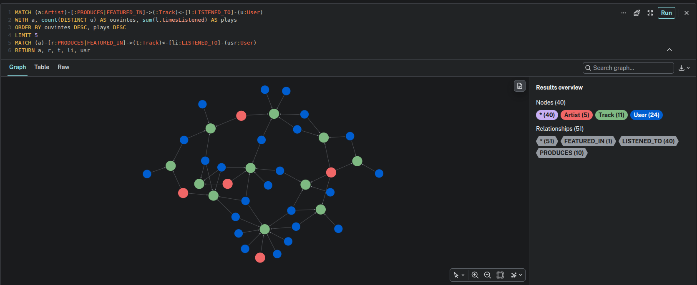
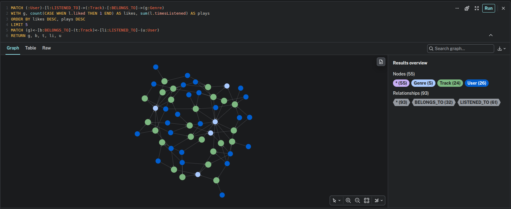
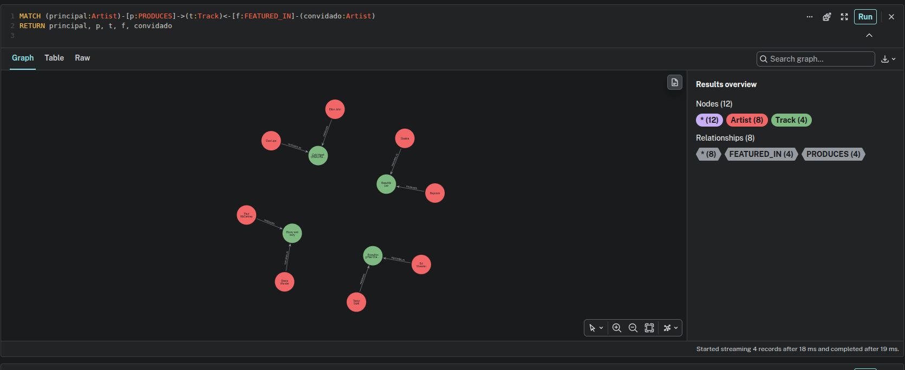
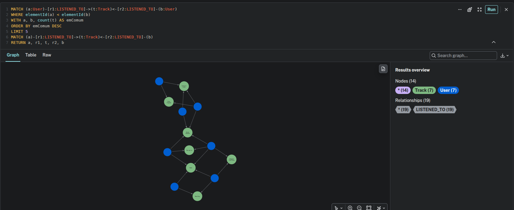
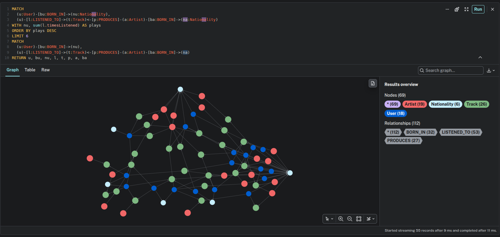
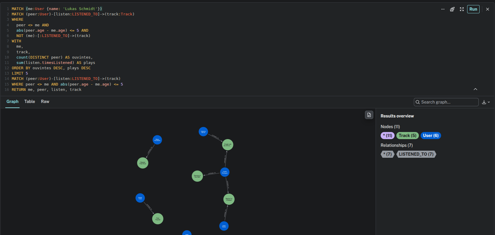

# 🎧 Graph Music: recomendação de músicas com Neo4j

Projeto do bootcamp **Neo4j (DIO)**. É uma rede de streaming de música modelada como **grafo** no
**Neo4j AuraDB**, com uma aplicação **Angular** que mostra, para cada ouvinte, o que ele já escutou e
**o que ouvir a seguir**, explicando *por que* cada música foi recomendada.

🔗 **Demo:** https://gbraga.github.io/bootcamp-ne4j-dio_music_recommendation/

## 📑 Sumário

1. [Contexto do problema](#-contexto-do-problema)
2. [Por que um banco de grafos?](#️-por-que-um-banco-de-grafos)
3. [Modelo do grafo](#️-modelo-do-grafo)
4. [Dataset](#-dataset)
5. [Scripts de carga (LOAD CSV)](#-scripts-de-carga-load-csv)
6. [Perguntas de negócio e evidências](#-perguntas-de-negócio-e-evidências)
7. [Os algoritmos de recomendação](#-os-algoritmos-de-recomendação)
8. [A aplicação](#-a-aplicação)
9. [Como executar](#-como-executar)
10. [Troubleshooting: dificuldades e soluções](#-troubleshooting-dificuldades-e-soluções)
11. [Arquitetura, publicação e tecnologias](#️-arquitetura)

---

## 🎯 Contexto do problema

Plataformas de streaming têm catálogos enormes, e o ouvinte não sabe o que procurar. O que segura o
usuário na plataforma é a **descoberta**: sugerir a próxima música certa. Para isso, o sistema precisa
responder perguntas que **cruzam várias entidades ao mesmo tempo**:

- *O que ouvem as pessoas da mesma geração que eu?*
- *Que outras músicas e parcerias têm os artistas que eu já escuto?*
- *Dos gêneros que eu curto, o que eu ainda não conheço?*
- *O que recomendar para quem acabou de se cadastrar e ainda não ouviu nada (cold start)?*

O sistema também precisa **explicar** cada sugestão ("porque você ouve Paul McCartney") e **aprender**
na hora: cada play ou curtida muda as próximas recomendações.

---

## 🕸️ Por que um banco de grafos?

Recomendação é, por natureza, um problema de **relacionamentos**: ouvinte → música → artista → outra
música. Com um banco relacional, cada salto vira uma tabela associativa e um `JOIN`. No Neo4j, o salto é
uma relação **armazenada fisicamente** que o banco percorre direto, sem precisar cruzar tabelas.

| Necessidade do projeto                                 | Relacional (SQL)                                          | Grafo (Neo4j / Cypher)                                    |
| ------------------------------------------------------ | --------------------------------------------------------- | --------------------------------------------------------- |
| "Outras músicas dos artistas que eu ouço"              | 4 tabelas e 3 `JOIN`s (`listens`, `track_artists`…)       | Um padrão: `(me)-[:LISTENED_TO]->()<-[:PRODUCES]-(a)-[:PRODUCES]->(t)` |
| Atributos da interação (plays, curtiu, desde quando)   | Colunas numa tabela associativa                           | Propriedades **na própria relação** `LISTENED_TO`         |
| Novo tipo de vínculo (ex.: parceria/feat.)             | Nova tabela e migração                                    | Novo tipo de relação: `FEATURED_IN`                       |
| Explicar a recomendação                                | Reconstruir o caminho a partir dos `JOIN`s                | O caminho percorrido **é** a explicação                   |
| Desempenho ao aumentar a profundidade                  | Cada `JOIN` a mais encarece a consulta                    | Custo proporcional à vizinhança visitada (*index-free adjacency*) |

O exemplo mais claro é a pergunta **P6** abaixo: "os ouvintes consomem música do próprio país?". Ela é
um caminho de 4 saltos (`Nationality ← User → Track ← Artist → Nationality`) que em Cypher cabe em uma
linha `MATCH`.

---

## 🗺️ Modelo do grafo

Esquema gerado com `CALL db.schema.visualization()` no Neo4j:


Com as propriedades de cada label e relacionamento (o GitHub renderiza o diagrama abaixo):



| Label          | Propriedades (tipo)                                                                                         | Chave única     |
| -------------- | ----------------------------------------------------------------------------------------------------------- | --------------- |
| `:User`        | `userId` (String), `name` (String), `age` (Integer)                                                         | `userId`        |
| `:Track`       | `trackId`, `name`, `release` (String, `AAAA-MM-DD`), `duration` (Integer, segundos), `previewUrl`, `appleMusicUrl` | `trackId` |
| `:Artist`      | `artistId`, `name`, `age` (Integer), `photoUrl`, `photoCredit`                                              | `artistId`      |
| `:Genre`       | `genreId`, `name`                                                                                           | `genreId`       |
| `:Nationality` | `nationalityId`, `name`                                                                                     | `nationalityId` |

| Relacionamento | De → Para                    | Propriedades                                                              | Significado                     |
| -------------- | ---------------------------- | ------------------------------------------------------------------------- | ------------------------------- |
| `LISTENED_TO`  | `User → Track`               | `timesListened` (Integer), `liked` (Boolean), `listenDate` (DateTime)     | O ouvinte escutou a música      |
| `PRODUCES`     | `Artist → Track`             | —                                                                         | Artista principal               |
| `FEATURED_IN`  | `Artist → Track`             | —                                                                         | Artista convidado (feat.)       |
| `BELONGS_TO`   | `Track → Genre`              | —                                                                         | Gênero da música (pode ter vários) |
| `BORN_IN`      | `User → Nationality`, `Artist → Nationality` | —                                                         | Nacionalidade                   |

**Decisões de modelagem**

- **A audição é uma relação, não um nó.** `timesListened`, `liked` e `listenDate` descrevem a *interação*
  entre ouvinte e música, por isso ficam em `LISTENED_TO`. Cada par ouvinte–música tem uma única relação,
  e um novo play só incrementa o contador.
- **`PRODUCES` e `FEATURED_IN` são separados.** Assim dá para distinguir o artista principal do convidado
  e encontrar parcerias com um padrão simples (`PRODUCES` de um lado, `FEATURED_IN` do outro).
- **Gênero e nacionalidade são nós, não propriedades.** Viram pontos de encontro no grafo: ouvintes e
  artistas do mesmo país ficam a um salto de distância.
- **`BORN_IN` é reutilizado** por `User` e `Artist`, o que permite comparar as duas nacionalidades no mesmo
  caminho (pergunta P6).

---

## 📦 Dataset

Dados em [`resources/datasets`](resources/datasets): um CSV por label e um por tipo de relacionamento.

| Arquivo                                                        | Conteúdo                                   | Linhas |
| -------------------------------------------------------------- | ------------------------------------------ | -----: |
| [`users.csv`](resources/datasets/users.csv)                    | Ouvintes (fictícios)                       |     25 |
| [`artists.csv`](resources/datasets/artists.csv)                | Artistas reais, com foto e crédito         |     25 |
| [`tracks.csv`](resources/datasets/tracks.csv)                  | Músicas reais (duração e lançamento reais) |     35 |
| [`genres.csv`](resources/datasets/genres.csv)                  | Gêneros                                    |     25 |
| [`nationality.csv`](resources/datasets/nationality.csv)        | Nacionalidades                             |     14 |
| [`listened_to.csv`](resources/datasets/listened_to.csv)        | Audições (`User → Track`)                  |     70 |
| [`belongs_to.csv`](resources/datasets/belongs_to.csv)          | `Track → Genre`                            |     52 |
| [`produces.csv`](resources/datasets/produces.csv)              | `Artist → Track` (principal)               |     36 |
| [`featured_in.csv`](resources/datasets/featured_in.csv)        | `Artist → Track` (feat.)                   |      4 |
| [`user_born_in.csv`](resources/datasets/user_born_in.csv) / [`artist_born_in.csv`](resources/datasets/artist_born_in.csv) | Nacionalidades | 25 + 25 |

**Amostra dos dados**

`users.csv`
```csv
user_name,user_age,userId
Ana Beatriz Souza,65,ZK904LNylb
Lucas Oliveira,41,fABxQhtZjw
```

`tracks.csv` (URLs encurtadas)
```csv
duration,trackId,name,release,preview_url,apple_music_url
194,R1uguOvNdp,Bad Guy,2019-03-29,https://audio-ssl.itunes.apple.com/…/mzaf_….m4a,https://music.apple.com/br/album/bad-guy/…
250,3oGIWQsmiY,País Tropical,1969-01-20,https://audio-ssl.itunes.apple.com/…/mzaf_….m4a,https://music.apple.com/br/album/pa%C3%ADs-tropical/…
```

`listened_to.csv`
```csv
trackId,userId,liked,listenDate,timesListened
9axhElNKGQ,ZK904LNylb,true,2013-08-17T03:33:38.577Z,18
TZLL61zguv,ZK904LNylb,false,2019-05-04T17:07:49.639Z,6
```

As audições foram geradas para serem **plausíveis**: nenhuma acontece antes do lançamento da música, nem
antes de o ouvinte ter idade para ouvi-la. As prévias de áudio vêm da **iTunes Search API** e as fotos, do
**Wikimedia Commons** (licenças livres, com autor e licença na coluna `photo_credit`).

---

## 📥 Scripts de carga (LOAD CSV)

O script completo e comentado está em
[`resources/cypher/01-carga-load-csv.cypher`](resources/cypher/01-carga-load-csv.cypher). Ele lê os CSVs
direto do GitHub, então funciona no AuraDB sem precisar enviar arquivos. A ordem é:

1. **Constraints de unicidade**, que também criam os índices usados nos `MATCH` da carga;
2. **Nós**, com conversão de tipos (`toInteger`, `nullIf`);
3. **Relacionamentos**, com `MATCH` nas duas pontas e `MERGE` da relação;
4. **Conferência** das quantidades e `CALL db.schema.visualization()`.

Trecho do script:

```cypher
// 1) Constraint: id único + índice para os MATCH/MERGE da carga
CREATE CONSTRAINT track_id IF NOT EXISTS FOR (t:Track) REQUIRE t.trackId IS UNIQUE;

// 2) Nós: o CSV entrega tudo como texto, então os números são convertidos.
//    Coluna vazia vira '' (e não null): nullIf evita gravar string vazia.
LOAD CSV WITH HEADERS
  FROM 'https://raw.githubusercontent.com/gbraga/bootcamp-ne4j-dio_music_recommendation/main/resources/datasets/tracks.csv' AS row
MERGE (t:Track {trackId: row.trackId})
SET t.name          = row.name,
    t.duration      = toInteger(row.duration),
    t.release       = row.release,
    t.previewUrl    = nullIf(row.preview_url, ''),
    t.appleMusicUrl = nullIf(row.apple_music_url, '');

// 3) Relacionamentos: as propriedades da audição ficam NA RELAÇÃO
LOAD CSV WITH HEADERS
  FROM 'https://raw.githubusercontent.com/gbraga/bootcamp-ne4j-dio_music_recommendation/main/resources/datasets/listened_to.csv' AS row
MATCH (u:User {userId: row.userId}), (t:Track {trackId: row.trackId})
MERGE (u)-[l:LISTENED_TO]->(t)
SET l.liked         = toBoolean(row.liked),
    l.listenDate    = datetime(row.listenDate),
    l.timesListened = toInteger(row.timesListened);
```

Tudo usa `MERGE`, então rodar o script de novo não duplica dados. Há duas alternativas ao LOAD CSV:

- **Neo4j Data Importer:** abra o modelo pronto
  [`neo4j_importer_model.json`](resources/datasets/neo4j_importer_model.json) e envie os CSVs.
- **Pela aplicação:** a mesma carga (mesmos `MERGE`/`SET`) está em
  [`seed-plan.ts`](music-recommender/src/app/data/seed/seed-plan.ts). Ela roda sozinha quando o banco está
  vazio ou com `npm run seed`.

---

## 📊 Perguntas de negócio e evidências

Todas as consultas estão em
[`resources/cypher/02-perguntas-de-negocio.cypher`](resources/cypher/02-perguntas-de-negocio.cypher). Cada
pergunta tem uma versão **TABELA** (os números) e, quando faz sentido, uma versão **GRAFO** (devolve
caminhos para o Neo4j Browser desenhar).

> Os resultados abaixo foram obtidos na instância de demonstração em 21/11/2026. Os números mudam
> conforme a aplicação é usada, porque cada play e cada like são gravados no grafo.

| #  | Pergunta de negócio                                      | Por que importa                                  |
| -- | -------------------------------------------------------- | ------------------------------------------------ |
| P1 | Quais são as músicas mais tocadas?                       | Destaques da home e cold start ("Top 3")         |
| P2 | Quais artistas alcançam mais ouvintes diferentes?        | Alcance vs. volume de plays                      |
| P3 | Quais gêneros os ouvintes mais curtem?                   | Curadoria de playlists por gênero                |
| P4 | Quais artistas colaboram entre si?                       | Descoberta por parcerias                         |
| P5 | Quais ouvintes têm gosto parecido?                       | Base para filtragem colaborativa                 |
| P6 | Os ouvintes consomem música do próprio país?             | Estratégia de catálogo regional                  |
| P7 | O gosto muda com a idade?                                | Justifica o algoritmo "Da sua geração"           |
| P8 | O que recomendar para um ouvinte específico?             | O produto em si                                  |

### P1. Quais são as músicas mais tocadas?

```cypher
MATCH (u:User)-[l:LISTENED_TO]->(t:Track)<-[:PRODUCES]-(a:Artist)
WITH t, collect(DISTINCT a.name) AS artistas, count(DISTINCT u) AS ouvintes, sum(l.timesListened) AS plays
RETURN t.name AS musica, artistas, ouvintes, plays
ORDER BY plays DESC LIMIT 5
```

| música                           | artista        | ouvintes | plays |
| -------------------------------- | -------------- | -------: | ----: |
| Construção                       | Chico Buarque  |        3 |   179 |
| Sorte Grande                     | Ivete Sangalo  |        7 |   158 |
| Happier Than Ever                | Billie Eilish  |        5 |   157 |
| Maybe I'm Amazed                 | Paul McCartney |        2 |   130 |
| Single Ladies (Put a Ring on It) | Beyoncé        |        3 |   115 |

**Insight:** *Construção* lidera em plays com apenas 3 ouvintes, enquanto *Sorte Grande* tem o maior
alcance (7). Ranquear só por plays favorece músicas de poucos fãs muito fiéis.




### P2. Quais artistas alcançam mais ouvintes diferentes?

```cypher
MATCH (a:Artist)-[:PRODUCES|FEATURED_IN]->(:Track)<-[l:LISTENED_TO]-(u:User)
RETURN a.name AS artista, count(DISTINCT u) AS ouvintes, sum(l.timesListened) AS plays
ORDER BY ouvintes DESC, plays DESC LIMIT 5
```

| artista        | ouvintes | plays |
| -------------- | -------: | ----: |
| Beyoncé        |        9 |   221 |
| Dua Lipa       |        8 |   121 |
| Ivete Sangalo  |        7 |   158 |
| Billie Eilish  |        6 |   261 |
| Caetano Veloso |        6 |    47 |

**Insight:** Billie Eilish tem o maior volume de plays (261), mas Beyoncé chega a mais pessoas. A
consulta conta `PRODUCES` e `FEATURED_IN`, então o alcance da Dua Lipa inclui os ouvintes da parceria
*Cold Heart*, além dos de *Levitating*.




### P3. Quais gêneros os ouvintes mais curtem?

```cypher
MATCH (:User)-[l:LISTENED_TO]->(:Track)-[:BELONGS_TO]->(g:Genre)
RETURN g.name AS genero, count(CASE WHEN l.liked THEN 1 END) AS likes, sum(l.timesListened) AS plays
ORDER BY likes DESC, plays DESC LIMIT 5
```

| gênero     | likes | plays |
| ---------- | ----: | ----: |
| Pop        |    10 |   756 |
| Eletrônica |     4 |   225 |
| R&B        |     3 |   221 |
| MPB        |     2 |   356 |
| Rock       |     2 |   237 |

**Insight:** MPB tem mais plays que Eletrônica e R&B, mas menos curtidas. Ouvir muito não é o mesmo que
curtir, e por isso o algoritmo "Gêneros que você curte" usa `liked`, não `timesListened`.




### P4. Quais artistas colaboram entre si?

```cypher
MATCH (principal:Artist)-[:PRODUCES]->(t:Track)<-[:FEATURED_IN]-(convidado:Artist)
RETURN principal.name AS artista, convidado.name AS convidado, t.name AS musica
```

| artista        | convidado     | música                  |
| -------------- | ------------- | ----------------------- |
| Taylor Swift   | Ed Sheeran    | Everything Has Changed  |
| Beyoncé        | Shakira       | Beautiful Liar          |
| Elton John     | Dua Lipa      | Cold Heart (PNAU Remix) |
| Paul McCartney | Stevie Wonder | Ebony and Ivory         |

**Insight:** cada parceria é uma ponte entre públicos. Quem ouve Elton John recebe Dua Lipa pelo
algoritmo "Dos seus artistas", e vice-versa.




### P5. Quais ouvintes têm gosto parecido?

```cypher
MATCH (a:User)-[:LISTENED_TO]->(t:Track)<-[:LISTENED_TO]-(b:User)
WHERE elementId(a) < elementId(b)          // cada par aparece uma vez só
WITH a, b, count(t) AS emComum, collect(t.name) AS musicas
RETURN a.name AS ouvinte1, b.name AS ouvinte2, emComum, musicas
ORDER BY emComum DESC LIMIT 5
```

| ouvinte 1         | ouvinte 2        | em comum | músicas                          |
| ----------------- | ---------------- | -------: | -------------------------------- |
| Ana Beatriz Souza | Fernanda Lima    |        3 | Haiti, Sorte Grande, Flor de Lis |
| Ana Beatriz Souza | Giulia Rossi     |        2 | Haiti, Happier Than Ever         |
| Lucas Oliveira    | João Pereira     |        2 | Crazy in Love, Sorte Grande      |
| Lucas Oliveira    | Carlos Hernández |        2 | País Tropical, Crazy in Love     |
| Margaret Thompson | Giulia Rossi     |        2 | Bad Guy, Haiti                   |

**Insight:** a semelhança sai de um único padrão de 2 saltos (`User → Track ← User`). É o ponto de partida
para a próxima evolução do projeto: recomendar "o que ouvintes parecidos com você também ouviram".




### P6. Os ouvintes consomem música do próprio país?

```cypher
MATCH (u:User)-[:BORN_IN]->(nu:Nationality),
      (u)-[l:LISTENED_TO]->(:Track)<-[:PRODUCES]-(:Artist)-[:BORN_IN]->(na:Nationality)
WITH nu.name AS nacionalidade,
     sum(l.timesListened) AS plays,
     sum(CASE WHEN nu = na THEN l.timesListened ELSE 0 END) AS playsNacionais
RETURN nacionalidade, plays, playsNacionais, round(100.0 * playsNacionais / plays, 1) AS pctNacional
ORDER BY plays DESC LIMIT 6
```

| nacionalidade  | plays | plays nacionais | % nacional |
| -------------- | ----: | --------------: | ---------: |
| Brasileira     |   413 |             346 |       83,8 |
| Porto-riquenha |   185 |               0 |        0,0 |
| Alemã          |   181 |               0 |        0,0 |
| Francesa       |   177 |               0 |        0,0 |
| Americana      |   154 |             142 |       92,2 |
| Portuguesa     |   124 |               0 |        0,0 |

**Insight:** brasileiros e americanos ouvem principalmente artistas do próprio país. Alemães, franceses
e portugueses não têm nenhum artista conterrâneo no catálogo, o que é uma **lacuna de catálogo
regional**. Já os porto-riquenhos têm o Bad Bunny no catálogo e não o ouvem: uma oportunidade de
recomendação para um algoritmo que cruze a nacionalidade do ouvinte com a do artista.



### P7. O que recomendar para um ouvinte específico?

Algoritmo "Da sua geração" para **Lukas Schmidt (26 anos)**: músicas de ouvintes com até 5 anos de
diferença que ele ainda não ouviu.

```cypher
MATCH (me:User {name: 'Lukas Schmidt'})
MATCH (peer:User)-[listen:LISTENED_TO]->(track:Track)
WHERE peer <> me AND abs(peer.age - me.age) <= 5 AND NOT (me)-[:LISTENED_TO]->(track)
WITH track, count(DISTINCT peer) AS ouvintes, sum(listen.timesListened) AS plays
RETURN track.name AS recomendacao, ouvintes, plays
ORDER BY ouvintes DESC, plays DESC LIMIT 5
```

| recomendação                     | ouvintes da geração | plays |
| -------------------------------- | ------------------: | ----: |
| Maybe I'm Amazed                 |                   2 |   130 |
| Single Ladies (Put a Ring on It) |                   2 |   104 |
| Dancing in the Dark              |                   1 |    46 |
| Happier Than Ever                |                   1 |    27 |
| País Tropical                    |                   1 |    24 |




---

## 🧠 Os algoritmos de recomendação

A aplicação combina **4 algoritmos** escritos em Cypher (arquivos em
[`data/queries`](music-recommender/src/app/data/queries)). Todos excluem músicas que o ouvinte **já
escutou**, e as músicas sugeridas por **mais de um algoritmo** sobem para o topo da lista.

### 1. 🟣 Da sua geração
Músicas que **outros ouvintes com até 5 anos de diferença de idade** estão escutando, ranqueadas pelo
Músicas que **outros ouvintes com até 5 anos de diferença de idade** estão escutando, ranqueadas pelo
número de ouvintes e, em seguida, pelo total de plays (é a consulta da P7 acima).
### 2. 🟢 Dos seus artistas
Outras músicas **e parcerias** dos artistas que o ouvinte já escuta, como artista principal ou convidado.
Por exemplo, quem ouve Paul McCartney recebe *Ebony and Ivory* (com Stevie Wonder).

```cypher
MATCH (me:User {userId: $userId})-[:LISTENED_TO]->(:Track)<-[:PRODUCES|FEATURED_IN]-(artist:Artist)
MATCH (artist)-[:PRODUCES|FEATURED_IN]->(track:Track)
WHERE NOT (me)-[:LISTENED_TO]->(track)
WITH track, collect(DISTINCT artist.name) AS knownArtists
RETURN track.trackId AS trackId,
       knownArtists,
       COUNT { (track)<-[:PRODUCES|FEATURED_IN]-(:Artist) } > 1 AS isPartnership
ORDER BY size(knownArtists) DESC, isPartnership DESC
```

### 3. 🟡 Top 3 da plataforma
As **3 músicas mais tocadas** de toda a plataforma (soma de `timesListened`) que o ouvinte ainda não ouviu.

```cypher
MATCH (me:User {userId: $userId})
MATCH (:User)-[listen:LISTENED_TO]->(track:Track)
WHERE NOT (me)-[:LISTENED_TO]->(track)
WITH track, sum(listen.timesListened) AS plays
RETURN track.trackId AS trackId, plays
ORDER BY plays DESC
LIMIT 3
```

### 4. 🩷 Gêneros que você curte
A partir das músicas que o ouvinte **curtiu**, encontra os **3 gêneros com mais likes** e recomenda outras
músicas desses gêneros.

```cypher
MATCH (me:User {userId: $userId})-[:LISTENED_TO {liked: true}]->(:Track)-[:BELONGS_TO]->(genre:Genre)
WITH me, genre, count(*) AS likes
ORDER BY likes DESC
LIMIT 3
MATCH (genre)<-[:BELONGS_TO]-(track:Track)
WHERE NOT (me)-[:LISTENED_TO]->(track)
WITH track, collect(genre.name) AS likedGenres, sum(likes) AS score
RETURN track.trackId AS trackId, likedGenres, score
ORDER BY score DESC
LIMIT 5
```

### ✍️ Bônus: escreva o seu próprio algoritmo
O card **"Seu algoritmo"** traz um editor de Cypher com destaque de sintaxe. A consulta recebe
`$userId`, deve retornar a coluna **`trackId`** e, opcionalmente, **`reason`** (o texto exibido como motivo
da recomendação). O exemplo inicial recomenda músicas **curtidas por ouvintes da mesma nacionalidade**:

```cypher
MATCH (me:User {userId: $userId})-[:BORN_IN]->(country:Nationality)
MATCH (country)<-[:BORN_IN]-(peer:User)-[:LISTENED_TO {liked: true}]->(track:Track)
WHERE peer <> me AND NOT (me)-[:LISTENED_TO]->(track)
WITH track, country, count(DISTINCT peer) AS fans
RETURN track.trackId AS trackId,
       'Curtida por ' + fans + ' ouvinte(s) de nacionalidade ' + country.name AS reason
ORDER BY fans DESC
LIMIT 10
```

> A consulta roda em **transação de leitura**: comandos de escrita (`CREATE`, `SET`, `DELETE`…) são
> rejeitados pelo próprio Neo4j.

---

## 💻 A aplicação

- Seleciona um ouvinte e exibe o **histórico** (plays, curtidas, desde quando ouve) e as
  **recomendações**, cada uma com o motivo.
- Cada algoritmo tem um card com sua cor, a consulta Cypher exibida (com botão de **copiar**) e um
  interruptor para **ativar ou desativar**. Clicar no card **destaca** as músicas que vieram dele.
- Cada card de música mostra o **total de plays** da faixa na plataforma.
- **＋ Novo ouvinte:** cria o nó `:User` ligado à `:Nationality` por `BORN_IN`. Mesmo **sem ter ouvido
  nada**, ele já recebe recomendações de "Da sua geração" (usa só a idade) e "Top 3" (popularidade geral),
  resolvendo o *cold start*.
- **Player com prévias de 30 s e ♥ curtir:** cada play e cada curtida são **gravados no grafo** e as
  recomendações se recalculam na hora:

```cypher
// ▶ play: cria a relação na primeira vez e soma um play nas seguintes
MERGE (user)-[listen:LISTENED_TO]->(track)
  ON CREATE SET listen.timesListened = 1, listen.liked = false, listen.listenDate = datetime()
  ON MATCH SET  listen.timesListened = listen.timesListened + 1

// ♥ like
MERGE (user)-[listen:LISTENED_TO]->(track)
SET listen.liked = $liked
```

É o ciclo completo: o novo ouvinte começa com "Da sua geração" e "Top 3" e, conforme ouve e curte,
"Dos seus artistas" e "Gêneros que você curte" entram em ação.

<!-- 📸 PRINT: docs/images/app-visao-geral.png (tela inicial com os cards de algoritmo e as recomendações) -->

---

## 🚀 Como executar

### Opção 1: só o banco (Neo4j Browser)

1. Crie uma instância gratuita no [Neo4j AuraDB](https://console.neo4j.io) (ou use um Neo4j local).
2. Abra o **Query / Neo4j Browser** e rode
   [`resources/cypher/01-carga-load-csv.cypher`](resources/cypher/01-carga-load-csv.cypher).
3. Confira com `CALL db.schema.visualization()` e explore as perguntas em
   [`02-perguntas-de-negocio.cypher`](resources/cypher/02-perguntas-de-negocio.cypher).

### Opção 2: a aplicação localmente

Pré-requisitos: **Node.js 20+** (testado com 24) e uma instância **Neo4j AuraDB**.

1. Copie [`.env.example`](.env.example) para `.env` e preencha com as credenciais da instância:

   ```dotenv
   NEO4J_URI=neo4j+s://<id>.databases.neo4j.io
   NEO4J_USERNAME=<usuário>
   NEO4J_PASSWORD=<senha>
   NEO4J_DATABASE=<database>
   ```

2. Instale e rode:

   ```bash
   cd music-recommender
   npm install
   npm start            # http://localhost:4200
   ```

Na primeira abertura, se o banco estiver vazio, a aplicação **importa os CSVs automaticamente**.

| Script          | O que faz                                                                    |
| --------------- | ---------------------------------------------------------------------------- |
| `npm start`     | Gera a configuração a partir do `.env`, copia os CSVs e sobe o servidor.     |
| `npm run seed`  | **Recria** o grafo: apaga todos os nós e reimporta os CSVs.                  |
| `npm test`      | Testes unitários (Vitest).                                                   |

### Opção 3: a demo publicada

https://gbraga.github.io/bootcamp-ne4j-dio_music_recommendation/

---

## 🩹 Troubleshooting: dificuldades e soluções

**1. Números do Neo4j chegavam como objetos `{low, high}` no JavaScript**
- *Causa:* o inteiro do Neo4j tem 64 bits, e o `number` do JavaScript não representa todos os valores
  com segurança. Por isso o driver devolve um tipo `Integer` próprio.
- *Solução:* criar o driver com `{ disableLosslessIntegers: true }`
  ([`neo4j-client.ts`](music-recommender/src/app/core/neo4j/neo4j-client.ts)). Os valores do projeto são
  pequenos, então a conversão para `number` é segura.

**2. Tudo vem do CSV como texto**
- *Causa:* `LOAD CSV` lê todas as colunas como `String`, e uma coluna vazia vira `''`, não `null`. Sem
  conversão, `sum(l.timesListened)` falha e o filtro `{liked: true}` não encontra nada, porque compara
  `'true'` (texto) com `true`.
- *Solução:* converter na carga com `toInteger()`, `toBoolean()` e `datetime()`, e usar `nullIf(valor, '')`
  para campos opcionais, como `preview_url` (*Tití Me Preguntó* não tem prévia).

**3. LOAD CSV no AuraDB**
- *Causa:* o AuraDB não tem a pasta `import/`, então `file:///` não funciona.
- *Solução:* ler os CSVs por URL pública (raw do GitHub) no script de carga. Na aplicação, os CSVs são
  copiados para `public/datasets` e enviados ao Neo4j como parâmetro (`UNWIND $rows`).

**4. Carga duplicada ou corrompida ao abrir duas abas**
- *Causa:* a importação automática roda quando o banco está vazio. Duas abas abertas ao mesmo tempo
  podiam importar em paralelo.
- *Solução:* constraints de unicidade, `MERGE` em vez de `CREATE` e a carga inteira **numa única
  transação** ([`seed-plan.ts`](music-recommender/src/app/data/seed/seed-plan.ts)).

**5. Executar Cypher digitado pelo usuário sem deixar apagar o banco**
- *Causa:* o card "Seu algoritmo" aceita qualquer Cypher.
- *Solução:* executar com `routing: READ` (transação de leitura). O próprio Neo4j rejeita `CREATE`,
  `SET` e `DELETE`. A consulta também precisa retornar `trackId`, e um erro aparece só no card, sem
  derrubar os outros algoritmos.

**6. Credenciais sem backend e deploy no GitHub Pages**
- *Problema:* sem backend, o driver roda no navegador e as credenciais vão no JavaScript publicado.
- *Solução:* `.env` fora do Git; o build gera `neo4j.env.ts` a partir dos **secrets** do repositório no
  GitHub Actions; e a instância é **exclusiva para demonstração**, restaurável pelos CSVs com
  `npm run seed`. Também foi preciso publicar com `--base-href /<repositório>/`, senão o Pages não
  encontra os arquivos.

**7. Prévias de áudio que não tocavam**
- *Causa:* as prévias da iTunes Search API são AAC (`.m4a`), e navegadores embutidos sem esse codec (como
  o do VS Code) não tocam o áudio.
- *Solução:* detectar com `canPlayType('audio/mp4; codecs="mp4a.40.2"')` e mostrar um aviso, em vez de
  falhar em silêncio.

**8. Fotos dos artistas: licença e links quebrados**
- *Solução:* usar só imagens com licença livre do Wikimedia Commons, exibir autor e licença
  (`photoCredit`), carregar com `referrerpolicy="no-referrer"` e voltar para uma capa em gradiente se a
  imagem falhar.

**9. Dados de exemplo verossímeis**
- *Cuidado:* datas de audição aleatórias podem cair antes do lançamento da música ou antes de o ouvinte
  ter idade para ouvi-la, o que distorce as análises por idade.
- *Solução:* gerar `listenDate` respeitando a data de lançamento e a idade, para que as perguntas de
  negócio (como a P7) façam sentido.

---

## 🏗️ Arquitetura

Aplicação **Angular sem backend**, que conversa direto com o AuraDB pelo driver oficial
(`neo4j-driver`), organizada em camadas (`features → domain → data → core`):

```
music-recommender/src/app
├── core/neo4j/        Conexão com o Neo4j (driver único, leitura/escrita)
├── data/
│   ├── queries/       Consultas Cypher em arquivos .cypher (o mesmo texto é executado e exibido)
│   ├── repositories/  Executam as consultas e devolvem dados tipados
│   └── seed/          Importação dos CSVs (automática quando o banco está vazio)
├── domain/            Modelos, algoritmos, união das recomendações e regras de usuário
├── features/          Componentes de UI (página, cards, sidebar, player, dialog de novo ouvinte)
└── shared/            Utilitários de apresentação (realce de Cypher, botão de copiar, duração)
```

Detalhes técnicos em [`music-recommender/README.md`](music-recommender/README.md).

## 🌐 Publicação (GitHub Pages)

O workflow em [`.github/workflows`](.github/workflows) faz o build e publica a cada push na `main`. As
credenciais vêm dos **Repository secrets** `NEO4J_URI`, `NEO4J_USERNAME`, `NEO4J_PASSWORD` e
`NEO4J_DATABASE` (*Settings → Secrets and variables → Actions*), e o Pages deve usar a fonte
**GitHub Actions** (*Settings → Pages*).

> ⚠️ **Aviso de segurança:** por não haver backend, as credenciais do AuraDB vão no JavaScript publicado
> e podem ser lidas por qualquer visitante. Use uma instância **exclusiva para demonstração** e troque a
> senha ao final da demo.

## 🛠️ Tecnologias

Neo4j AuraDB · Cypher · Angular 22 (signals, standalone components) · TypeScript · neo4j-driver ·
Vitest · GitHub Actions / Pages

Fotos dos artistas: [Wikimedia Commons](https://commons.wikimedia.org) (CC BY, CC BY-SA e domínio público),
com autor e licença exibidos na aplicação.
